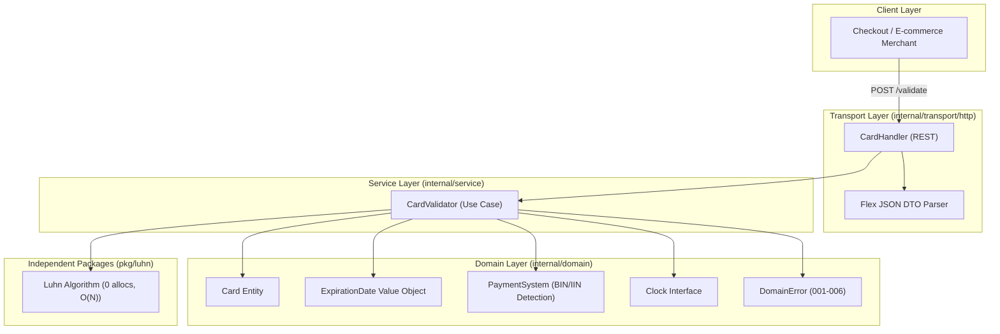

# 💳 Card Validator API (Fintech Payment Gateway)

[](https://golang.org)
[](https://github.com/mykhailokishko/api-service)
[](https://www.docker.com)
[](https://blog.cleancoder.com/uncle-bob/2012/08/13/the-clean-architecture.html)
[](LICENSE)

Високопродуктивний мікросервіс валідації банківських карток перед відправкою до банку-еквайра, побудований за стандартами **Clean Architecture**, **Zero-Allocation Algorithms** та фінтех-специфікацією компанії **Solidgate**.

---

## 🌟 Ключові особливості інженерної реалізації

- ⚡ **Zero-Allocation Luhn (Mod 10)**: алгоритм Луна реалізований як чистий $O(N)$ прохід по байтовому рядку справа наліво. Працює за **~40ns на перевірку** з показником **0 B/op та 0 allocs/op** (нульовий тиск на Garbage Collector під навантаженням).
- 🧩 **Гнучкий DTO парсер**: кастомний `UnmarshalJSON` прозоро й безпечно приймає змішані типи payload (`string` або `number`) без втрати точності для 16-19 значних PAN.
- 🕒 **Детерміноване тестування часу (Clock Provider)**: дата закінчення терміну дії картки валідується відносно інтерфейсу `Clock`, що забезпечує 100% стабільність тестів у CI/CD незалежно від плину часу.
- 🏛 **Clean Architecture**: повна ізоляція доменного ядра від деталей реалізації HTTP-транспорту та фреймворків.
- 🛡️ **DevOps & Безпека**: безпечний multi-stage Dockerfile на базі непривілейованого користувача (`UID 10001`), конфігурація `docker-compose.yml`, повноцінний `Makefile` та Graceful Shutdown.

---

## 🏛 Архітектура сервісу



### Структура проекту:
```plaintext
api-service/
├── cmd/
│   └── api/
│       └── main.go                  # Composition Root, DI, Graceful Shutdown
├── internal/
│   ├── domain/                      # Доменне ядро: Card, ExpirationDate, Clock, Errors
│   ├── service/                     # Use Cases: CardValidator оркестратор
│   └── transport/
│       └── http/                    # HTTP REST: Handlers, Request/Response DTO
├── pkg/
│   └── luhn/                        # Чиста математична бібліотека Луна (0 allocs)
├── docs/                            # Повна інженерна документація та лекції
├── Dockerfile                       # Multi-stage production build
├── docker-compose.yml               # Однокомандний запуск
├── Makefile                         # Автоматизація збірки та тестів
├── .golangci-lint.yml               # Конфігурація лінтера
└── README.md
```

---

## 🚀 Швидкий старт

### Варіант 1: Запуск через Docker Compose (Рекомендовано)
```bash
docker compose up -d --build
```
Сервіс підніметься на порту `8080`.

### Варіант 2: Локальний запуск
```bash
make run
# або
go run ./cmd/api
```

### Запуск тестів та перевірка покриття:
```bash
make test   # Запуск усіх юніт- та інтеграційних тестів із -race детектором
make cover  # Генерація звіту про покриття коду (>90%)
make bench  # Запуск тестів продуктивності алгоритму Луна
```

---

## 📬 API Контракт та cURL приклади

Ендпоінт: `POST /validate` або `POST /api/v1/cards/validate`

### 1. Валідна картка (Happy path):
```bash
curl -X POST http://localhost:8080/validate \
  -H "Content-Type: application/json" \
  -d '{
    "card_number": "4111111111111111",
    "expiration_month": 12,
    "expiration_year": 2028
  }'
```
**Відповідь (HTTP 200 OK):**
```json
{
  "valid": true
}
```

### 2. Валідна картка з гнучкими типами (номер як число, дата як рядок):
```bash
curl -X POST http://localhost:8080/validate \
  -H "Content-Type: application/json" \
  -d '{
    "card_number": 4111111111111111,
    "expiration_month": "10",
    "expiration_year": "2026"
  }'
```
**Відповідь (HTTP 200 OK):**
```json
{
  "valid": true
}
```

### 3. Невалідна картка за алгоритмом Луна (ТЗ Solidgate):
```bash
curl -X POST http://localhost:8080/validate \
  -H "Content-Type: application/json" \
  -d '{
    "card_number": "1111111111111111",
    "expiration_month": 10,
    "expiration_year": 2028
  }'
```
**Відповідь (HTTP 200 OK):**
```json
{
  "valid": false,
  "error": {
    "code": "002",
    "message": "Invalid card number"
  }
}
```

### 4. Прострочена картка (ТЗ Solidgate):
```bash
curl -X POST http://localhost:8080/validate \
  -H "Content-Type: application/json" \
  -d '{
    "card_number": "4111111111111111",
    "expiration_month": 1,
    "expiration_year": 2021
  }'
```
**Відповідь (HTTP 200 OK):**
```json
{
  "valid": false,
  "error": {
    "code": "001",
    "message": "Card has expired"
  }
}
```

### 5. Некоректний місяць (13-й місяць):
```bash
curl -X POST http://localhost:8080/validate \
  -H "Content-Type: application/json" \
  -d '{
    "card_number": "4111111111111111",
    "expiration_month": 13,
    "expiration_year": 2028
  }'
```
**Відповідь (HTTP 200 OK):**
```json
{
  "valid": false,
  "error": {
    "code": "003",
    "message": "Invalid expiration month"
  }
}
```

---

## 📚 Документація проекту

Повні інженерні матеріали та конспекти доступні у теці [`docs/`](docs/):
- [01. Правила та критерії розробки](docs/01_RULES.md)
- [02. Бізнес-вимоги від Solidgate](docs/02_REQUIREMENTS.md)
- [03. Архітектура Clean Architecture](docs/03_ARCHITECTURE.md)
- [04. Домен карт та Алгоритм Луна](docs/04_DOMAIN_AND_ALGORITHMS.md)
- [05. Ключові інженерні рішення та пастки](docs/05_DECISIONS_AND_PITFALLS.md)
- [06. План та статус прогресу спринтів](docs/06_PROGRESS_PLAN.md)
- [07. Лекції (Go internals, DI, SOLID, GoF, ACID, System Design)](docs/07_LECTURES_AND_INTERVIEW.md)
- [08. Журнал фідбеку та підготовки до співбесіди](docs/08_FEEDBACK_AND_RETRO.md)
